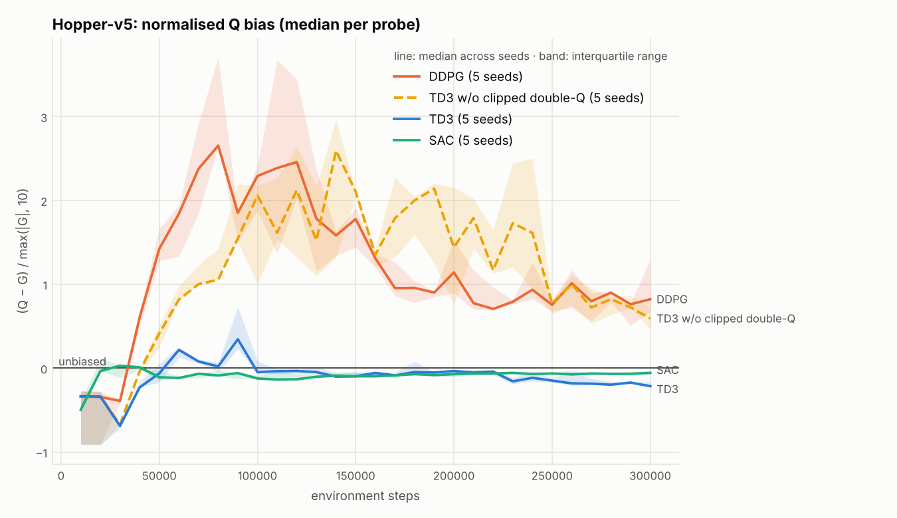

# criticlab

**Single-file deep RL algorithms that tell you whether their critic can be trusted.**

Every run regularly plays a few episodes, measures what actually happened, and compares that with what the critic predicted. You get overestimation, calibration and twin-critic disagreement for DDPG, TD3, SAC, PPO and DQN in one standard figure, alongside the usual learning curve.



*Hopper-v5, 5 seeds, 300k steps. Above zero, the critic promises more return than the policy delivers. Line: median across seeds; band: interquartile range.*

## Why measure the critic?

Because the learning curve hides it. In our week-2 sweep, DDPG, TD3 and TD3 without clipped double-Q reached **statistically indistinguishable returns** on both Hopper and HalfCheetah (Welch p = 0.59–0.87 at 300k steps). Yet their critics were very different:

| Environment | Algorithm | Return at 300k | Normalised Q bias (median) |
|---|---|---|---|
| Hopper-v5 | DDPG | 1,124 ± 730 | **+0.95** (overestimates) |
| Hopper-v5 | TD3 w/o clipped double-Q | 1,597 ± 934 | **+0.82** (overestimates) |
| Hopper-v5 | TD3 | 1,475 ± 1,179 | −0.18 |
| Hopper-v5 | SAC | 2,781 ± 990 | −0.06 |
| Hopper-v5 | PPO (V critic) | 2,727 ± 1,036 | −0.002 |
| HalfCheetah-v5 | DDPG | 7,580 ± 829 | +0.03 |
| HalfCheetah-v5 | TD3 w/o clipped double-Q | 7,635 ± 688 | −0.13 |
| HalfCheetah-v5 | TD3 | 7,510 ± 418 | **−0.26** (underestimates) |
| HalfCheetah-v5 | SAC | 9,044 ± 817 | −0.10 |
| HalfCheetah-v5 | PPO (V critic) | 1,912 ± 815 | −0.003 |

*Mean ± sample std over 5 seeds. Bias is (Q − G) / max(|G|, 10) per state, as in REDQ; median over states, then mean over seeds. PPO's critic is V(s); its rows are the 300k probe of 1M-step runs.*

What the critics show:

- **DDPG overestimates on Hopper, not on HalfCheetah.**
- **Clipped double-Q does 89% of TD3's bias correction on Hopper.** Without it, TD3's critic is as biased as DDPG's.
- **On HalfCheetah, TD3 overcorrects into consistent underestimation** (−0.258 ± 0.013 across seeds).
- **Among the Q-critics, SAC's ranks states best** (Spearman 0.86 on Hopper, 0.72 on HalfCheetah).
- **PPO's value critic is the only one unbiased in both environments** (−0.002 and −0.003, neither distinguishable from zero), as theory predicts for on-policy targets with no maximisation. Unbiased is not the same as informative: on HalfCheetah it ranks states worst of all five (Spearman 0.45).
- **PPO's own critic metric can't see bias.** Explained variance ranged from −3.3 to 1.0 on critics that were all within 2% of the truth. See [`docs/findings_week3.md`](docs/findings_week3.md).
- **DQN's CartPole values overshoot what any policy can earn, and the target network is why.** With CleanRL's defaults, DQN's largest prediction peaks near 250 against a hard ceiling of 100. In a pre-registered test, copying the target every 5,000 steps instead of 500 removed the overshoot (−148 [−154, −142] above the copy envelope); Double DQN made no difference at either rate. The fix costs sample efficiency, and the policy reached a perfect score despite the overshoot. See [`docs/findings_week4.md`](docs/findings_week4.md).
- **Cheap signals don't replace the probe.** TD error and twin disagreement separate algorithms, but within a run they do not track the measured bias once training trends and the size of Q are removed, and they rose before a collapse about as often as chance. See [`docs/findings_q1_signals.md`](docs/findings_q1_signals.md).

Full analysis, statistics and limits: [`docs/findings_week2.md`](docs/findings_week2.md) (DDPG, TD3, SAC), [`docs/findings_week3.md`](docs/findings_week3.md) (PPO, GAE λ) and [`docs/findings_week4.md`](docs/findings_week4.md) (DQN, Double DQN, target network).

## Quickstart

Works on Linux and Windows, on CPU. No GPU needed.

```bash
git clone https://github.com/hano03/criticlab && cd criticlab
pip install -e ".[dev]"
python -m pytest -q                      # 49 tests, about 30 s

# one run: TD3 on Hopper, 100k steps (about 15 minutes on a laptop CPU)
python -m criticlab.td3 --env-id Hopper-v5 --seed 0 --total-timesteps 100000

# the standard 6-panel figure (+ the hero figure) for every run under runs/
python scripts/plot_report.py runs --out figures/my_runs.png
```

Every run writes `runs/<run>/critic_report.json`, holding every probe's metrics plus sample (Q, G) pairs, and TensorBoard logs in the same folder.

**Reproduce the week-2 results:** `python scripts/run_week2.py` (40 runs). Use `--dry-run` first to print the job list and time estimate: about 34 CPU-hours, roughly 6 hours on a 14-core laptop with 6 runs at once. The sweep is resumable: rerun the same command after an interruption and finished runs are skipped.

## What the probe measures

Every 10k steps (configurable), the probe plays episodes with the current policy on a separate copy of the environment. For each visited state–action pair it compares the critic's Q(s, a) with the discounted return G that actually followed:

| Metric | Meaning |
|---|---|
| Normalised bias (mean and median over states) | Over- or underestimation, comparable across environments |
| Spearman(Q, G) | Does a higher Q really mean a better outcome? |
| Twin disagreement \|Q1 − Q2\| | A cheap uncertainty signal (TD3, SAC) |
| TD error, target size | Early warnings of divergence |

Details that matter, all tested:

- **Termination vs time limit.** After a fall the return really ends. After a time-limit cutoff it doesn't, so states too close to the cutoff are excluded.
- **Soft returns for SAC.** SAC's critic predicts reward plus an entropy bonus. Comparing it with plain returns would wrongly make it look overestimated, so the probe uses soft returns with the current α.
- **Robust summaries.** When a policy briefly collapses, its critic keeps predicting the old values; one seed's normalised bias jumped to +32 that way. The figures therefore offer median-based views alongside REDQ's mean.

Full definitions: [`docs/diagnostics.md`](docs/diagnostics.md).

## Algorithms

| File | Algorithm | Notes |
|---|---|---|
| [`criticlab/td3.py`](criticlab/td3.py) | TD3 (Fujimoto et al., 2018) | CleanRL hyperparameters; `--no-clipped-double-q` for the ablation |
| [`criticlab/ddpg.py`](criticlab/ddpg.py) | DDPG (Lillicrap et al., 2016) | Written as `td3.py` minus TD3's three fixes, so `diff` shows exactly what TD3 adds |
| [`criticlab/sac.py`](criticlab/sac.py) | SAC (Haarnoja et al., 2018) | Automatic α; probed with soft returns |
| [`criticlab/ppo.py`](criticlab/ppo.py) | PPO (Schulman et al., 2017) | CleanRL hyperparameters; V(s) probed in real reward units; bootstraps through time limits. 1M steps: Hopper 3,278 ± 66, HalfCheetah 2,793 ± 1,260 |
| [`criticlab/dqn.py`](criticlab/dqn.py) | DQN (Mnih et al., 2015), Double DQN (van Hasselt et al., 2016) | CleanRL hyperparameters; `--double` for Double DQN; greedy-policy probe. Return over 400k–500k: CartPole 476.6 ± 26.5, Acrobot −84.9 ± 1.3 |

**Design rules:**
- **One file per algorithm, readable top to bottom.**
- **The diagnostics are the only shared code.** They use NumPy only, so they work with any framework.
- **One environment per run, reset by hand,** so `terminated` and `truncated` are never confused in the replay buffer.
- **Verified against the reference:** TD3 matches CleanRL's TD3 on the same machine (318.9 against 298.1 mean return at 100k steps on Hopper, 3 seeds).

## Repository layout

```text
criticlab/
├── criticlab/
│   ├── diagnostics.py        # the probe: Monte Carlo returns, bias, calibration, report file
│   ├── td3.py  ddpg.py  sac.py  ppo.py  dqn.py
├── scripts/
│   ├── plot_report.py        # standard 6-panel figure + hero figure
│   ├── run_week2.py          # any sweep: parallel, resumable, with a time estimate
│   ├── run_week3.py          # the PPO sweep: main grid + GAE λ study
│   ├── run_week4.py          # the DQN sweep: target period × Double DQN, pre-registered
│   ├── dqn_check.py          # DQN / Double DQN quick check on CartPole and Acrobot
│   ├── summarize_sweep.py    # per-seed results table with Welch tests
│   ├── launch.py             # parallel runner used by the scripts above
│   ├── smoke_test.py         # every algorithm, a few thousand steps on Pendulum
│   ├── last_returns.py       # compare end-of-run returns with CleanRL logs
│   └── analyze_signals.py    # do TD error / twin disagreement track the measured bias?
├── tests/                    # 92 tests: returns, metrics, probe, GAE, plots, sweeps, smoke runs
└── docs/
    ├── diagnostics.md        # what each metric means, how to read the figures
    ├── findings_week2.md     # the week-2 results in full
    ├── findings_week3.md     # PPO and GAE λ
    ├── findings_week4.md     # DQN, Double DQN, target network
    ├── findings_q1_signals.md  # cheap signals vs the probe
    └── implementation_details.md
```

## Prior work and credits

- **REDQ** (Chen et al., 2021): our soft-return recursion and per-state normalised bias follow its [Monte Carlo bias evaluator](https://github.com/watchernyu/REDQ/blob/main/redq/utils/bias_utils.py). criticlab differs in handling time-limit truncation explicitly, adding calibration and twin-disagreement metrics, and applying one tested probe across algorithms.
- **[DDPG vs TD3 overestimation study on LunarLander](https://github.com/Elta305/DDPG-TD3-Overestimation-bias-LunarLander):** a related one-off comparison of bias and Q–return correlation.
- **[CleanRL](https://github.com/vwxyzjn/cleanrl)** (Huang et al., 2022): the single-file philosophy and the hyperparameters of every algorithm here.

## Roadmap

- A new finding rather than a reproduction (candidates: the cost of TD3's underestimation, critic behaviour around collapses, early optimism with small GAE λ).
- Walker2d and Ant if time allows.

## Citation

```bibtex
@misc{criticlab,
  author = {hano03},
  title  = {criticlab: single-file deep RL algorithms with critic diagnostics},
  year   = {2026},
  url    = {https://github.com/hano03/criticlab}
}
```

## License

MIT (see [`LICENSE`](LICENSE)).
