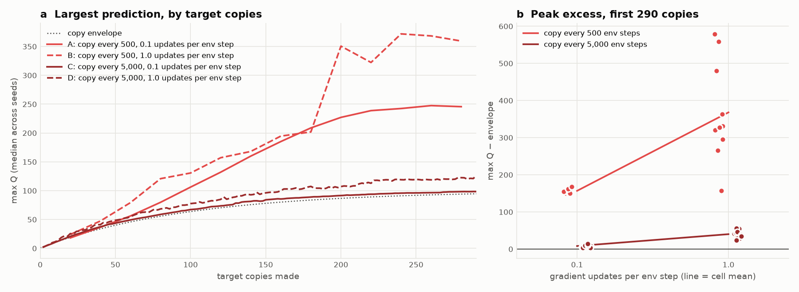

# Week 5: what makes DQN's values run away on CartPole

*criticlab · 2026-11-17 · two pre-registered tests: `docs/preregistration_week5.md` (commit `21bc385`) and
`docs/preregistration_week5b.md` (commit `2e232fb`), each pushed before its runs · reproduce with §8*

**Question.** In week 4, copying DQN's target network every 5,000 env steps instead of every 500
removed the overshoot on CartPole: max-Q fell from about 250 to just under the ceiling of 100. That
change raised two things at once: the gradient updates made against each frozen target (50 → 500),
and the env steps between copies. Which one matters?

**Answer.** Not the updates per copy. At a fixed copy interval, ten times more updates per copy
*more than doubled* the overshoot (test 1, outcome AGAINST). What mattered was the copy interval in
env steps:

- Copying every 5,000 steps removed 91% of the overshoot even at a ten times higher replay ratio
  (test 2, outcome PROTECTS).
- It did not remove all of it. At the high replay ratio, the slow-target critic still overestimated,
  was still drifting upwards at the end of training, and earned a lower return.
- The replay ratio is a second factor. Its harm is about seven times smaller when copies are far
  apart.



*CartPole-v1, plain DQN, 10 seeds per cell.*
- *Left: the median across seeds of the largest predicted value on probe states, against the number of
  target copies made, with the copy envelope (dotted).*
- *Right: each seed's peak excess over the envelope within the first 290 copies. Each line joins two
  cell means.*

## 1. Three linked quantities

DQN as configured by CleanRL has three linked settings:

- **the copy interval** K: env steps between hard copies of the target network;
- **the replay ratio** ρ: gradient updates per env step, here one training call every 10 steps
  times the gradient steps per call;
- **updates per copy**, U = K · ρ.

Because of that identity, any one experiment moves two of the three:

| | K (copy every) | ρ (updates per env step) | U (updates per copy) |
|---|---|---|---|
| Week 4 | raised ×10 | fixed | raised ×10 |
| Test 1 (week 5) | fixed | raised ×10 | raised ×10 |
| Test 2 (week 5b) | the missing corner: high K and high ρ together | | |

All measurements use week 4's instruments:

- `bias/q_max`, the largest prediction on the probe states. It is compared with CartPole's hard
  ceiling of 100 (no policy is worth more) and with the **copy envelope**
  E(n) = 100 (1 − 0.99^(n+1)), the most that n hard copies can honestly support
  (`docs/findings_week4.md`, §2).
- The overshoot is the **peak excess** of max-Q over E(n).

## 2. Setup

- **Shared settings.** CartPole-v1 and plain DQN, with CleanRL's settings otherwise:
  - a 10k-transition buffer, batch 128, Adam 2.5e-4;
  - one training call every 10 env steps;
  - ε reaches 0.05 at 250k steps.
- **Probes.** Every 10k steps, 10 greedy episodes of up to 1,000 steps each.
- **Runs.** 10 seeds per configuration. Runs with copies every 500 last 500k steps. Runs with copies
  every 5,000 last 1.5M steps (298 copies), with `--exploration-fraction 1/6`.
- **The new flag.** `dqn.py --gradient-steps k` makes k updates per training call, each on a fresh
  batch, against the same frozen target. With k = 1, a run is bit-identical to the week-4 code, and a
  test checks this.
- **Statistics.** Differences between means come with 95% Welch confidence intervals on per-seed
  values. Each test's outcome is applied by its script (`run_week5.py`, `run_week5b.py`) using the
  rule written beforehand.

## 3. Test 1: more updates per frozen target, fixed copy interval

**Hypothesis.** The overshoot is controlled by the number of gradient updates against each frozen
target.

**Design.** The copy interval is fixed at 500 env steps, and the configurations use 1, 3 or 10
gradient steps per call. That gives U = 50 (the default), 150 or 500 updates per copy, at a replay
ratio of 0.1, 0.3 or 1.0.

**Primary measure.** Peak excess over the envelope, all probes up to 500k. The copy schedules are
identical, so copies, envelope and ε match at every probe.

**Predictions:**

- **P1, which decides the outcome.** At 500 updates per copy, the excess falls by at least 75%, with
  the interval below 0.
- **P2.** The means fall in order 50 > 150 > 500, with a negative Spearman ρ.
- **P3.** At 500 updates per copy, no probe exceeds 110.

| Updates per copy (replay ratio) | Peak excess, ≤ 500k (primary) | Peak max-Q (step) | Probes > 110 | Return, 400k–500k | Median bias, 400k–500k |
|---|---|---|---|---|---|
| 50 (0.1), default | +156.9 ± 6.6 | 249.3 ± 6.5 (140k) | 57% | 485.9 ± 21.4 | +0.071 ± 0.090 |
| 150 (0.3) | +140.8 ± 45.2 | 228.0 ± 48.4 (134k) | 88% | 460.1 ± 48.2 | +0.179 ± 0.126 |
| 500 (1.0) | +388.6 ± 138.8 | 481.2 ± 138.3 (146k) | 92% | 430.7 ± 42.9 | +0.639 ± 0.295 |

**Outcome: AGAINST.** All three predictions failed.

- **P1.** 500 vs 50 updates per copy: **+231.8 [+132.4, +331.1]**, p < 0.001. The overshoot grew
  instead of disappearing.
- **P2.** 150 vs 50: −16.0 [−48.5, +16.4], with 7× the spread. Spearman ρ = +0.62, p < 0.001: the
  opposite sign.
- **P3.** The largest max-Q of any seed was 673.5.
- **The default reproduced week 4** (+156.9 ± 6.6 against +154.9 ± 5.1, new seeds), so the
  precondition held.
- **Not predicted.** At 500 updates per copy:
  - max-Q was still near 150 at 500k;
  - the median bias stayed at +0.64;
  - return was 55 lower ([−87.9, −22.5], p = 0.003).

**Correction.** The test 1 pre-registration named a next test: copies every 5,000 with 50 updates per
copy. Because U = K · ρ, that test would also have cut the replay ratio to 0.01, so it could not have
separated anything. It was withdrawn before any run (progress log, Day 30), and test 2 replaced it.

## 4. Test 2: the slow target at the high replay ratio

**Design.** A 2×2 of copy interval × replay ratio:

- Cells A and B are test 1's runs.
- Cell C pools week 4's seeds 0–4 with new seeds 5–9.
- Cell D is new.

The script reads each cell only from its pre-registered folder and seeds.

**Primary measure.** Week 4's measure: peak excess over the envelope within the first 290 copies.
Copies must be matched, because the copy interval differs.

**The rule, with no direction predicted.** Protection P = (B − D) / (B − C), from the cell means.

- **PROTECTS**: P ≥ 0.75, and the interval for D − B lies below 0.
- **DOES NOT**: P ≤ 0.25.
- **PARTLY**: anything in between.

| Cell | Copy every | Updates per env step (per copy) | Peak excess, first 290 copies (primary) | Peak excess, first 500k steps | Peak max-Q | Probes > 110 | Return, last 100k | Median bias, last 100k |
|---|---|---|---|---|---|---|---|---|
| A | 500 | 0.1 (50) | +156.9 ± 6.6 | +156.9 ± 6.6 | 249.3 ± 6.5 | 57% | 485.9 ± 21.4 | +0.071 ± 0.090 |
| B | 500 | 1.0 (500) | +368.1 ± 132.9 | +388.6 ± 138.8 | 481.2 ± 138.3 | 92% | 430.7 ± 42.9 | +0.639 ± 0.295 |
| C | 5,000 | 0.1 (500) | +8.3 ± 3.3 | +4.9 ± 1.3 | 100.0 ± 3.0 | 0% | 472.3 ± 43.5 | +0.002 ± 0.044 |
| D | 5,000 | 1.0 (5,000) | +40.2 ± 10.6 | +18.4 ± 5.8 | 132.6 ± 10.6 | 29% | 370.2 ± 91.8 | +0.571 ± 0.412 |

*"Last 100k" means 400k–500k for A and B, and 1.4M–1.5M for C and D. B's primary value differs from
test 1's because the window differs (first 290 copies, about 155k steps, against all probes up to
500k).*

**Outcome: PROTECTS.**

- **D − B = −327.9 [−423.1, −232.7]**, p < 0.001, so **P = 0.91**.
- The precondition held: C = +8.3 (week 4 alone: +7.1), and B − C = +359.8.

| Contrast (not predicted) | Peak excess, first 290 copies | Return, last 100k |
|---|---|---|
| C − A: slower copies at ρ = 0.1 (week 4's effect) | −148.6 [−153.7, −143.6], p < 0.001 | −13.6 [−46.7, +19.5], p = 0.39 |
| B − A: higher ρ with copies every 500 (test 1's effect) | +211.2 [+116.1, +306.3], p < 0.001 | −55.2 [−87.9, −22.5], p = 0.003 |
| D − C: higher ρ with copies every 5,000 | **+31.9 [+24.2, +39.6]**, p < 0.001 | **−102.0 [−171.5, −32.6]**, p = 0.007 |
| Interaction (D − C) − (B − A) | **−179.3 [−274.5, −84.1]** | – |

**The script's outcome sentence overstates the result.** It was written before the data, and it says
that the copy interval "not the replay ratio" decides. The data say more than that:

- **The replay ratio still matters at the slow target.** Going from 0.1 to 1.0 adds +31.9 to the
  excess, puts 29% of D's probes above 110 (none of C's), raises the late median bias to +0.57, and
  costs 102 in return.
- **The slow target slows the runaway; it does not stop it.** In the figure, D's median max-Q pulls
  further above the envelope copy after copy. It is still rising at 1.5M steps (about 123 against an
  envelope near 95).
- **What the label does mean.** PROTECTS stands by the pre-registered rule. It means that most of the
  high-ratio overshoot (91% within the matched window) is gone. It does not mean the critic is fine.

## 5. Reading the two tests together

- **Updates per copy is not a useful single explanation.** Cells B and C both make 500 updates
  against each frozen target, but their excess differs about 45-fold (+368 against +8).
- **The copy interval in env steps is the dominant factor.** At either replay ratio, spacing the
  copies out removed most of the overshoot (−149 at ρ = 0.1; −328 at ρ = 1.0).
- **The replay ratio is a second, amplifying factor.** Raising it tenfold added +211 with frequent
  copies, but only +32 with sparse ones. The interaction is clearly negative.
- **The return tells a related story.** Overshoot and lost return go together within each copy
  interval. But the slow target's protection of the value estimate did not protect the return at the
  high ratio (D: 370 against C: 472).

**Two hypotheses, post hoc, now under test.** One quantity separates the two fast-copy cells from
the two slow-copy cells: *how many target copies happen per turnover of the replay buffer*, buffer
size / K.

- With copies every 500 steps on a 10k buffer, that is 20 copies per turnover (A and B).
- With copies every 5,000, it is 2 (C and D).

Within each pair, it is the replay ratio that sets the order, not this quantity.

- **Turnover.** With 20 copies per turnover, each new target is fitted largely on the same
  transitions as the last. An error that one copy writes into the target can therefore be
  bootstrapped again and again from the same data, and a higher ρ strengthens that loop. On this
  reading, a *larger* buffer at fixed K and ρ means more copies per turnover and so *more* overshoot.
- **Overfitting.** The network overfits a small, narrow dataset and extrapolates badly outside it.
  On this reading, a larger, more varied buffer means *less* overshoot.

The two predict opposite effects of buffer size. Buffer size also leaves the number of replays per
transition unchanged (ρ × batch = 12.8), so it separates the two cleanly. Week 4's rejection rule
had already listed the buffer as the next suspect.

The test is pre-registered in `docs/preregistration_week5c.md`: buffer sizes of 2,500, 10,000 and
40,000 at the default K and ρ.

## 6. What this means

- **For DQN users.** On CartPole with CleanRL's defaults, the target copy interval should be judged
  in env steps (new data), not in gradient updates. Doing more updates per step without spacing the
  copies further apart made the overshoot much worse. With copies spaced out, a tenfold higher replay
  ratio was far less harmful to the value estimate, but it still cost return.
- **For criticlab.** Two things proved their worth:
  - **The copy envelope** made all three comparisons fair. Without it, every slow-target cell would
    have looked good merely because its values had less time to grow.
  - **Pre-registration** caught a weak next test before it was run, and made a negative result
    (test 1) as reportable as a positive one.
- **Relation to prior work:**
  - van Hasselt et al. (2018) showed that target networks reduce soft divergence; weeks 4–5 confirm
    this on a small task, controlling for value propagation.
  - Fedus et al. (2020) studied replay capacity and the replay ratio systematically in Q-learning
    agents. D'Oro et al. (2023) showed that high replay ratios pay off only with extra measures such
    as parameter resets.
  - The new piece here is narrow: on CartPole, the harm of a tenfold higher replay ratio to DQN's
    value estimates depends strongly on the target copy interval, and the number of updates per copy
    does not explain the effect.

## 7. Limitations

- **Copies-matched is not stage-matched.** The 290th copy comes at about 155k steps in A and B, and
  at about 1.46M in C and D. The steps-matched measure agrees in direction: within the first 500k
  steps, A +157, B +389, C +5, D +18.
- **Cell D had not settled.** Its max-Q was still rising at 1.5M steps. Longer runs might show a
  larger overshoot, so "91% removed" applies to the first 290 copies only.
- **Test 2's question was chosen after seeing cells A, B and half of C.** Only the measure and the
  rule were fixed before D was run.
- **Cell C pools two sweeps** run weeks apart on the same machine with the same code. Week 4's seeds
  alone gave +7.1, and the pool gave +8.3.
- **The scope is narrow.** One environment with two actions, one buffer size, one learning rate, and
  replay ratios up to 1.0. Modern high-replay-ratio methods go well beyond that.
- **Seeds are not reproducible across machines.** Only aggregates are compared.

## 8. Reproduce

```bash
python scripts/run_week5.py --max-parallel 10            # test 1: 30 runs, figures/week5_summary.md
python scripts/run_week4.py --max-parallel 10            # week 4 (cell C, seeds 0–4)
python scripts/run_week5b.py --max-parallel 10           # test 2: 15 new runs, figures/week5b_summary.md
python scripts/run_week5b.py --summary-only              # tables and figures from existing runs
```

## Corrections

- **Day 33.** §5 first said that the turnover hypothesis predicts *less* overshoot from a larger
  buffer. That is backwards: a larger buffer gives more copies per turnover, so the hypothesis
  predicts more. §5 also said that copies per turnover "orders all four cells"; it only separates
  the fast-copy pair from the slow-copy pair. Both are corrected above. No result or statistic
  changed.

## References

- Mnih et al. (2015). *Human-level control through deep reinforcement learning* (DQN).
- van Hasselt et al. (2018). *Deep Reinforcement Learning and the Deadly Triad* (soft divergence).
- Fedus et al. (2020). *Revisiting Fundamentals of Experience Replay.* ICML.
- D'Oro et al. (2023). *Sample-Efficient Reinforcement Learning by Breaking the Replay Ratio Barrier.* ICLR.
- Huang et al. (2022). *CleanRL.* JMLR 23(274).
